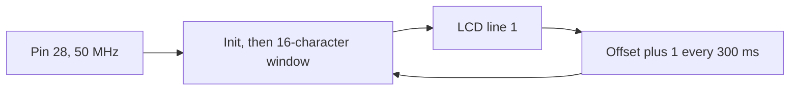

# Lab 1 teaching session: one file becomes an image

Teach this before any O-RAN block. The student opens the project, compiles it, finds the `.sof`, and loads it.

Device: `EP1C6Q240C8`. One Verilog file: `lab001.v`. Top module: `lab001`.

## 1. The path

Verilog does not run line by line. Quartus turns `lab001.v` into a configuration. JTAG writes that configuration into the FPGA SRAM.


| Box | What to say |
| --- | --- |
| `lab001.v` | One Verilog file. It writes the lesson result to the LCD and scrolls it left. |
| Quartus 11 | Compile from `lab001.qpf`. Opening only the `.v` file leaves Start Compilation off. |
| `lab001.sof` | The image. It sits next to the project file, not in `output_files`. |
| JTAG | USB-Blaster on the JTAG header. The RUN/PROG switch stays on RUN. |
| EP1C6 SRAM | The chip holds the image only while power is on. |

## 2. Inside the chip

Pin 28 is the 50 MHz clock. The LCD pins are D0–D7 on 223–216, RS 215, RW 214, and E 213. RW stays 0.



| Block | What it is |
| --- | --- |
| Pin 28 | Board oscillator, 50 MHz. The SDC period is 20.000 ns. |
| Window | 16 characters of `ERR 0  SLACK 15.430ns  SOF 0x0009032A`. Sixteen leading spaces let the text enter from the right. |
| Shift | After each line, `offset` increases by 1. At the end of the message it returns to 0, so the scroll repeats. |
| SRAM configuration | Holds which LUTs and flip-flops are used. It is not a program counter. |

This compile uses 235 of about 5,980 logic elements.

## 3. Three commands

Run these from this directory. PowerShell needs `.\` because the command is in the current folder.

```powershell
.\compile
.\check
.\upload
```

| Command | What the student should see |
| --- | --- |
| `.\compile` | Quartus II 11 finishes. Read the error count before the warnings. |
| `.\check` | 0 errors, then setup slack, then the `.sof` path and checksum. |
| `.\upload` | JTAG mode, IDCODE `020820DD`. Do not program the `.pof`. |

The LCD scrolls the lesson check from the first complete timing run:

| Item | Value on the LCD |
| --- | --- |
| Errors | 0 |
| Setup slack | 15.430 ns |
| SOF checksum | `0x0009032A` |

Source of that line: Quartus II 11.0, `lab001`, 2 Nov 2026 11:47. Clock constraint 20 ns on pin 28.

The image that drives the LCD is a later compile (2 Nov 2026 12:57). Its own setup slack is 5.321 ns and its `.sof` checksum is `0x000B2A85`. `.\check` prints that later file. The text on the glass stays the 11:47 lesson line.

Read the error count first. Negative slack from a 1 ns period means `lab001.sdc` was not applied. If `.\check` says the timing report has no slack, run `.\compile` again, then `.\check`.

## 4. After power off

| Board state | What is true |
| --- | --- |
| Power on, after `.\upload` | SRAM holds `lab001`. The LCD scrolls the lesson line from right to left, then repeats. |
| Power off, then on | SRAM is empty. The image is gone. That is the correct result. This lab does not write the `.pof` into the EPCS4. |

The habit to carry to the O-RU: know which image is in the chip. Open the `.qpf`, compile, find the `.sof`, and load it again after a small edit.
